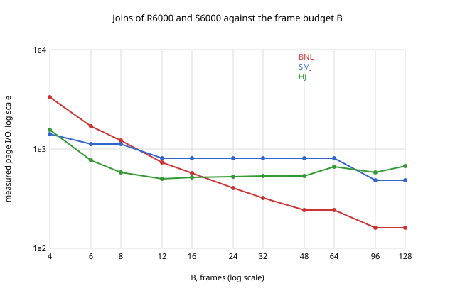
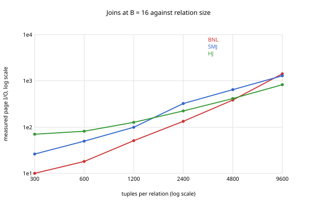

# REPORT_M2.md: execution engine measurements

Machine: Apple M5 Pro, 24 GB, macOS 26.5.2, Apple clang 21.0.0, `-std=c++17 -O2`. Every number comes from `python3 perf/m2.py`. It builds the tables with `./storage`, runs plans with `./exec`, and writes `perf/m2/results.md` (the tables below) and the two plots. It took 44 seconds. The counters are deterministic, and they don't depend on the buffer policy. I ran it a second time with `--policy lru` given to every `exec`, and it wrote identical tables and plots to the default, CLOCK.

The data is `R(a INT, b INT, pad VARCHAR(40))` and `S(b INT, c INT, pad VARCHAR(40))`. They have n tuples each. The join keys are permutations of 0 to n − 1, so each R tuple matches exactly one S tuple and the output has n tuples. A record is 54 bytes, so 75 fit on a page. That makes 1500, 6000 and 24000 tuples 20, 80 and 320 data pages. Every scan also reads its table's directory page, which the formulas don't count.

## 1 Cost against formula

Measured is the whole plan: both scans plus the join's own reads and writes.

| join | M = N pages | B | measured reads | measured writes | measured total | formula | measured / formula |
|---|---|---|---|---|---|---|---|
| BNL | 20 | 4 | 231 | 0 | 231 | 220 | 1.05 |
| BNL | 20 | 16 | 63 | 0 | 63 | 60 | 1.05 |
| BNL | 20 | 64 | 42 | 0 | 42 | 40 | 1.05 |
| BNL | 20 | 256 | 42 | 0 | 42 | 40 | 1.05 |
| SMJ | 20 | 4 | 162 | 120 | 282 | 240 | 1.18 |
| SMJ | 20 | 16 | 122 | 80 | 202 | 160 | 1.26 |
| SMJ | 20 | 64 | 82 | 40 | 122 | 80 | 1.52 |
| SMJ | 20 | 256 | 82 | 40 | 122 | 80 | 1.52 |
| HJ | 20 | 4 | 152 | 44 | 196 | 120 | 1.63 |
| HJ | 20 | 16 | 100 | 58 | 158 | 120 | 1.32 |
| HJ | 20 | 64 | 168 | 126 | 294 | 120 | 2.45 |
| HJ | 20 | 256 | 550 | 508 | 1058 | 120 | 8.82 |
| BNL | 80 | 4 | 3321 | 0 | 3321 | 3280 | 1.01 |
| BNL | 80 | 16 | 567 | 0 | 567 | 560 | 1.01 |
| BNL | 80 | 64 | 243 | 0 | 243 | 240 | 1.01 |
| BNL | 80 | 256 | 162 | 0 | 162 | 160 | 1.01 |
| SMJ | 80 | 4 | 786 | 624 | 1410 | 1280 | 1.10 |
| SMJ | 80 | 16 | 482 | 320 | 802 | 640 | 1.25 |
| SMJ | 80 | 64 | 482 | 320 | 802 | 640 | 1.25 |
| SMJ | 80 | 256 | 322 | 160 | 482 | 320 | 1.51 |
| HJ | 80 | 4 | 1395 | 164 | 1559 | 480 | 3.25 |
| HJ | 80 | 16 | 338 | 176 | 514 | 480 | 1.07 |
| HJ | 80 | 64 | 414 | 252 | 666 | 480 | 1.39 |
| HJ | 80 | 256 | 672 | 510 | 1182 | 480 | 2.46 |
| BNL | 320 | 4 | 51681 | 0 | 51681 | 51520 | 1.00 |
| BNL | 320 | 16 | 7704 | 0 | 7704 | 7680 | 1.00 |
| BNL | 320 | 64 | 2247 | 0 | 2247 | 2240 | 1.00 |
| BNL | 320 | 256 | 963 | 0 | 963 | 960 | 1.00 |
| SMJ | 320 | 4 | 3842 | 3200 | 7042 | 6400 | 1.10 |
| SMJ | 320 | 16 | 2562 | 1920 | 4482 | 3840 | 1.17 |
| SMJ | 320 | 64 | 1922 | 1280 | 3202 | 2560 | 1.25 |
| SMJ | 320 | 256 | 1922 | 1280 | 3202 | 2560 | 1.25 |
| HJ | 320 | 4 | 18196 | 642 | 18838 | 1920 | 9.81 |
| HJ | 320 | 16 | 1657 | 656 | 2313 | 1920 | 1.20 |
| HJ | 320 | 64 | 1354 | 712 | 2066 | 1920 | 1.08 |
| HJ | 320 | 256 | 1638 | 996 | 2634 | 1920 | 1.37 |

Block nested loop agrees with the formula to the page, once the directory pages are counted. The outer scan reads its directory page once, and the inner scan reads its directory page once per pass. So measured = formula + 1 + ceil(M / (B − 2)). At M = 320, B = 4 that is 51520 + 1 + 160 = 51681, which is the measured number. Its comparisons were |R| · |S| in every run (the test `block nested loop compares exactly |R| x |S| pairs, at every B`), whatever B was.

Sort-merge join goes over the formula by M + N writes and two directory reads, in every row but one. For example, 4482 = 3840 + 640 + 2 at M = 320, B = 16. The formula's sort(M) = 2M(passes − 1) + M counts the final pass of the sort as a read that streams into its parent. My merge join can't stream the final passes of its sorts, because it would then need 2(B − 1) frames for the two final merges. So it writes each side's final pass as one sorted run and reads that run in the merge. That costs M + N writes that the formula leaves out. The formula's "+ M + N" for the merge's reads matches what my merge does. The one exception is M = 80, B = 4, where 1410 is 1280 + 162 − 32. There, each sort carries an 8 page run through its third pass untouched (section 2). That saves reading and writing those 8 pages on each side, which is 32 page I/Os that the formula counts. The ratio is highest when both sides fit in one run (B ≥ 64 at 20 pages). Then the formula's sort costs only its input read, but my join still writes and rereads the sorted runs.

Hash join goes away from the formula in two directions, for two different reasons.

First, partition pages are part full when B is large. P = B − 1 partitions are used whatever the input size, as the module says. At B = 256 with 20 page inputs, 255 partitions each get about six tuples. So each partition is a part full page of its own. That is 254 pages written per side instead of 20, and then read back. I measured 1058 against 120. The formula assumes every partition page is full, and that only holds when M is much larger than P. A real system would pick P from the expected input size. At M = 320 the same effect shows up as the slow rise from 2066 at B = 64 to 2634 at B = 256.

Second, partitions overflow when B is small. Grace hash join needs each build partition, about M / (B − 1) pages, to fit in B − 1 frames. That means roughly B ≥ √M. At B = 4 and M = 320 the three partitions are 107 pages each. Every one overflows and is joined by the block nested loop fallback with a 2 page block. So the probe phase reads each S partition 54 times, giving 18838 against 1920. At M = 80 the partitions are 27 pages, and the same thing costs a factor of 3.25. This is the "do something defensible" path working as designed. The result is right and the memory stays at 4 frames, but the formula has no term for it.

Between these two cases the hash join is within 7% to 20% of the formula. That covers B = 16 or 64 at M = 320 and B = 16 at M = 80. The difference is the part full last page of each partition, which is written and read once, and the two directory pages.

## 2 Sort passes

The sort input is R itself, sorted on b descending. I read the pass counts from the operator's trace.

| N pages | B | runs after pass 0 | measured passes | 1 + ceil(log(ceil(N/B)) / log(B − 1)) | sort's own reads | sort's own writes | scan reads |
|---|---|---|---|---|---|---|---|
| 20 | 4 | 5 | 3 | 3 | 40 | 40 | 21 |
| 80 | 4 | 20 | 4 | 4 | 232 | 232 | 81 |
| 80 | 8 | 10 | 3 | 3 | 160 | 160 | 81 |
| 320 | 16 | 20 | 3 | 3 | 640 | 640 | 321 |
| 320 | 4 | 80 | 5 | 5 | 1280 | 1280 | 321 |
| 320 | 64 | 5 | 2 | 2 | 320 | 320 | 321 |

Measured equals the formula in all six rows. The I/O shows the carry strategy at work. With N = 80, B = 4, pass 1 merges the 20 runs in groups of three (the last group has two) into 7 runs. Pass 2 merges the first six of those and carries the seventh, an 8 page run, through untouched. So pass 2 reads and writes 72 pages instead of 80. The sort's own I/O is 232 + 232, which is below the 2N(passes − 1) = 480 that rewriting every run would give. Where every group is full (N = 320, B = 16: 20 runs into groups of 15 and 5), nothing is carried, and the I/O is exactly 2N(passes − 1) = 1280 split evenly. The module's worked example (N = 8, B = 3: 22 reads, 14 writes, 3 passes) is a test, and it passes.

## 3 Crossover



R6000 and S6000 (M = N = 80 pages), with B varied:

| B | BNL I/O | SMJ I/O | HJ I/O | cheapest |
|---|---|---|---|---|
| 4 | 3321 | 1410 | 1559 | SMJ |
| 6 | 1701 | 1122 | 763 | HJ |
| 8 | 1215 | 1122 | 582 | HJ |
| 12 | 729 | 802 | 502 | HJ |
| 16 | 567 | 802 | 514 | HJ |
| 24 | 405 | 802 | 530 | BNL |
| 32 | 324 | 802 | 534 | BNL |
| 48 | 243 | 802 | 538 | BNL |
| 64 | 243 | 802 | 666 | BNL |
| 96 | 162 | 482 | 582 | BNL |
| 128 | 162 | 482 | 670 | BNL |

The ranking changes twice.

The first change is from SMJ to HJ between B = 4 and 6. At B = 4 every hash partition overflows (section 1), while the sort only needs one more pass.

The second change is from HJ to BNL between B = 16 and 24. The nested loop costs 81 + ceil(80 / (B − 2)) · 81, which falls as the block gets bigger. It meets the hash join's roughly flat 510 to 530 when ceil(80 / (B − 2)) ≤ 5, which is at B ≥ 18. From B = 82, the whole of R fits in one block, so it is a single pass over each table (162).

The merge join is flat in some stretches. Those are the B values with the same pass count. Each input needs 2 passes from B = 12 to 64 and 1 pass from 96.

The hash join gets worse as B grows past 16. This is the part full page effect from section 1.



B = 16, with both relations varied together:

| tuples per side | M = N pages | BNL I/O | SMJ I/O | HJ I/O | cheapest |
|---|---|---|---|---|---|
| 300 | 4 | 10 | 26 | 70 | BNL |
| 600 | 8 | 18 | 50 | 82 | BNL |
| 1200 | 16 | 51 | 98 | 126 | BNL |
| 2400 | 32 | 132 | 322 | 222 | BNL |
| 4800 | 64 | 390 | 642 | 410 | BNL |
| 9600 | 128 | 1419 | 1282 | 818 | HJ |

The nested loop wins while R fits in a few blocks of 14 pages. Its cost is M + ceil(M / 14) · N, which grows with the square of the size. The hash join's cost grows linearly. They cross between 64 and 128 pages. At M = 64 the nested loop needs 5 blocks (390, against 410 for the hash join). At M = 128 it needs 10 (1419 against 818). The hash join's fixed overhead at small sizes is again its 15 part full partition pages per side. That is why it is the most expensive of the three below 32 pages.

## 4 Skew

`K` and `L` have 6000 tuples each, with key 7 in 40% of the rows on both sides (the rest are uniform). The same tables without the hot key are the uniform case. Here is the hash join at B = 16:

| data | partitions (pages left/right) | overflowed | reads | writes | comparisons | output |
|---|---|---|---|---|---|---|
| uniform | 15 partitions of 5 to 10 pages | 0 | 338 | 176 | 15582 | 6000 |
| skewed | 14 partitions of 3 to 6 pages, and one of 35/35 | 1 | 402 | 170 | 6882580 | 5768400 |

All 2400 hot tuples of each side hash to the same partition. It is 35 pages, against the 15 frames the probe phase can give a build partition. No hash function can split it, because every tuple in it has the same key. My overflow handling joined that one pair of partitions by block nested loop. It took 35 pages of build side in blocks of 14 (two frames go to reading the two partitions), so ceil(35/14) = 3 passes over the 35 page probe side. The other 14 partitions were hashed normally. The cost in I/O is small: 572 against 514 uniform (+11%), which is the extra two passes over the hot partition. The real cost is somewhere else. The hot key alone makes 2400 · 2400 = 5,760,000 output tuples, and the fallback compares every pair in that partition. That is 6.9 million comparisons against 15,582. So skew is much more a CPU and output problem than an I/O problem. The formula 3(M + N) counts neither of those, so it predicts neither.

## 5 The budget

Here is a sort of `Twenty` (82 data pages, which is more than 20 · B = 80) at B = 4:

```
sort tuples_out=6600 comparisons=82556 reads=236 writes=236 passes=4
  seqscan Twenty tuples_out=6600 comparisons=0 reads=83 writes=0
```

It completes in 4 passes (the formula gives 1 + ceil(log 21 / log 3) = 4). The most frames held at once was 4, and I know that from the buffer pool, not from the operator saying so. Working memory is frames reserved from the pool (DESIGN_M2.md section 2). The pool counts every frame that is pinned or reserved and records the maximum (`peak`). `exec run --json` reports it as `peak_frames`. A reservation past B fails with "no unpinned frame available" instead of being granted. So the 4 is both measured and enforced. Every test plan at B = 4 checks that `peak_frames <= 4` and that nothing is still pinned afterwards.

## 6 What materialising an input costs

This is a hash group_by over a hash join. The join holds memory, so the group_by writes the join's output to a temporary file before it takes memory itself (DESIGN_M2.md section 2):

```
B = 16, peak frames 16
group_by hash tuples_out=6000 comparisons=14856 reads=268 writes=169 levels=1 partitions=15 spilled_pages=[1,1,1,1,1,1,1,1,1,1,1,1,1,1,1]
  hash_join tuples_out=6000 comparisons=25320 reads=168 writes=168 partitions=14 pages_left/right=[6/6,...] overflowed=0
    seqscan R6000 tuples_out=6000 comparisons=0 reads=81 writes=0
    seqscan S6000 tuples_out=6000 comparisons=0 reads=81 writes=0
```

The group_by's own 169 writes are 154 pages of join output (6000 tuples of 100 bytes, 39 to a page) written once, and 15 pages of partitions. Its 6000 groups did not fit in its 15 frames. So it read the join output again and split it 15 ways, keeping only the 4 byte key it groups on, one page per partition. Its 268 reads are the 154 pages read back, the first 99 of them read once more before that while its table filled, and the 15 partitions. So materialising costs 2 × 154 = 308 page I/Os here, which is 33% of the plan's 935. A fully pipelined executor would not pay that, but it would have needed two operators holding memory at once. Also, the join runs with 14 partitions, not 15, because it leaves one frame for the group_by's writer. At B = 8 that left it 6 partitions of 13 to 15 pages, which all overflowed (6 million comparisons). So that one frame matters most when memory is tight.

## 7 Hash distinct against its formula

This is a hash distinct of R, where all the tuples differ, so its groups take as many pages as its input. The formula is the one in DESIGN_M2.md section 6, with R = G = N and read(x) = N. The I/O is for the whole plan. That means the scan's reads, which include the input read again when a level partitions, plus the distinct's own:

| N pages | B | levels | partitions per split | scan reads | own reads | own writes | total I/O | formula | measured / formula |
|---|---|---|---|---|---|---|---|---|---|
| 80 | 4 | 4 | 3 | 86 | 405 | 313 | 804 | 617 | 1.30 |
| 80 | 8 | 2 | 7 | 90 | 238 | 182 | 510 | 507 | 1.01 |
| 80 | 16 | 1 | 15 | 98 | 89 | 89 | 276 | 275 | 1.00 |
| 80 | 64 | 1 | 63 | 146 | 125 | 125 | 396 | 395 | 1.00 |
| 80 | 256 | 0 | 255 | 81 | 0 | 0 | 81 | 80 | 1.01 |
| 320 | 4 | 5 | 3 | 326 | 2294 | 1814 | 4434 | 4361 | 1.02 |
| 320 | 8 | 3 | 7 | 330 | 775 | 695 | 1800 | 1713 | 1.05 |
| 320 | 16 | 2 | 15 | 338 | 1016 | 776 | 2130 | 2135 | 1.00 |
| 320 | 64 | 1 | 63 | 386 | 350 | 350 | 1086 | 1139 | 0.95 |
| 320 | 256 | 1 | 255 | 578 | 503 | 503 | 1584 | 1595 | 0.99 |

One level of partitions is the normal case. Every split uses all B − 1 frames, so a single level is enough once (B − 1)² ≥ N. That is from B = 16 at N = 80 and from B = 64 at N = 320. A level that partitions reads its input again. So the scan reads B + 1 pages more than its 81 or 321. Those are the B data pages it read until the table was full (every tuple was a new group), plus its directory page once more. In the rows with one level, the distinct's own reads equal its writes, because every partition written is read back once. With more levels its reads are higher, by the pages each lower level reads before its table fills.

In eight of the ten rows the measurement is within 5% of the formula. The formula assumes that a level's partitions are all the same size. At N = 80, B = 4 the third level writes 27 partitions that it expects at 80 / 27 = 2.96 pages, just under the 3 frames. With their part full pages, 11 of the 27 came out at 4 pages and needed a fourth level, which is the 30%. N = 320 at B = 8 is the same effect, but smaller. 3 of the 49 second level partitions came out at 8 pages, over the 7 frames. Where the measurement is below the formula, the formula has rounded every partition up. At N = 320, B = 64 it counts 6 pages for each of the 63 partitions, and 28 of them took 5.

The executor before the last one gave the table and the partition buffers half the frames each. That is one partition at B = 4 and two at B = 5. Each level then took out only the groups that fit in the table and wrote the rest again, so the I/O grew with the square of the input. At B = 4, `SELECT DISTINCT eid, pid, hours FROM Works` on the scale 5 data (59 pages) cost 3058 page I/Os that way. This executor's hash distinct costs 521, against 414 for the sort. The optimizer's estimates for the two are 518 and 413, so it picks the sort.

## 8 Sources

Ramakrishnan and Gehrke, chapters 13 and 14, give the external sort's pass count and the three join cost formulas measured here. Shapiro, *Join Processing in Database Systems with Large Main Memories*, ACM TODS 1986, gives the grace hash join and the condition (roughly B ≥ √M) under which its partitions fit. That explains the B = 4 rows of section 1 and when one level is enough in section 7. DESIGN_M2.md section 8 says what each one changed in the design.
