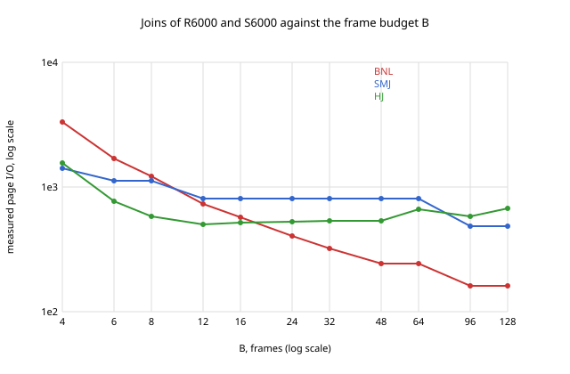
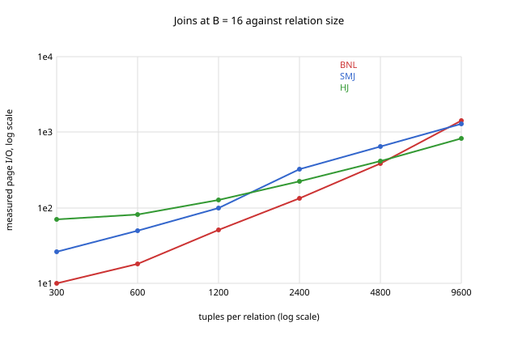

# REPORT_M2.md: execution engine measurements

Machine: Apple M5 Pro, 24 GB, macOS 26.5.2, Apple clang 21.0.0, `-std=c++17 -O2`. Every number comes
from `python3 perf/m2.py`, which builds the tables with `./storage`, runs plans with `./exec`, and writes
`perf/m2/results.md` (the tables below) and the two plots. It took 44 seconds. The counters are
deterministic, and they do not depend on the buffer policy: a second run with `--policy lru` given to
every `exec` wrote identical tables and plots to those of the default, CLOCK.

The data: `R(a INT, b INT, pad VARCHAR(40))` and `S(b INT, c INT, pad VARCHAR(40))`. They have n tuples
each, with join keys that are permutations of 0 to n − 1, so each R tuple matches exactly one S tuple and
the output has n tuples. At 54 bytes a record, 75 fit on a page: 1500, 6000 and 24000 tuples are 20, 80
and 320 data pages. Every scan also reads its table's directory page, which the formulas do not count.

## 1 Cost against formula

Measured is the whole plan: both scans plus the join's own reads and writes.

| join | M = N pages | B | measured reads | measured writes | measured total | formula | measured / formula |
|---|---|---|---|---|---|---|---|
| BNL | 20 | 4 | 231 | 0 | 231 | 220 | 1.05 |
| BNL | 20 | 16 | 63 | 0 | 63 | 60 | 1.05 |
| BNL | 20 | 64 | 42 | 0 | 42 | 40 | 1.05 |
| BNL | 20 | 256 | 42 | 0 | 42 | 40 | 1.05 |
| SMJ | 20 | 4 | 162 | 120 | 282 | 240 | 1.18 |
| SMJ | 20 | 16 | 122 | 80 | 202 | 160 | 1.26 |
| SMJ | 20 | 64 | 82 | 40 | 122 | 80 | 1.52 |
| SMJ | 20 | 256 | 82 | 40 | 122 | 80 | 1.52 |
| HJ | 20 | 4 | 152 | 44 | 196 | 120 | 1.63 |
| HJ | 20 | 16 | 100 | 58 | 158 | 120 | 1.32 |
| HJ | 20 | 64 | 168 | 126 | 294 | 120 | 2.45 |
| HJ | 20 | 256 | 550 | 508 | 1058 | 120 | 8.82 |
| BNL | 80 | 4 | 3321 | 0 | 3321 | 3280 | 1.01 |
| BNL | 80 | 16 | 567 | 0 | 567 | 560 | 1.01 |
| BNL | 80 | 64 | 243 | 0 | 243 | 240 | 1.01 |
| BNL | 80 | 256 | 162 | 0 | 162 | 160 | 1.01 |
| SMJ | 80 | 4 | 786 | 624 | 1410 | 1280 | 1.10 |
| SMJ | 80 | 16 | 482 | 320 | 802 | 640 | 1.25 |
| SMJ | 80 | 64 | 482 | 320 | 802 | 640 | 1.25 |
| SMJ | 80 | 256 | 322 | 160 | 482 | 320 | 1.51 |
| HJ | 80 | 4 | 1395 | 164 | 1559 | 480 | 3.25 |
| HJ | 80 | 16 | 338 | 176 | 514 | 480 | 1.07 |
| HJ | 80 | 64 | 414 | 252 | 666 | 480 | 1.39 |
| HJ | 80 | 256 | 672 | 510 | 1182 | 480 | 2.46 |
| BNL | 320 | 4 | 51681 | 0 | 51681 | 51520 | 1.00 |
| BNL | 320 | 16 | 7704 | 0 | 7704 | 7680 | 1.00 |
| BNL | 320 | 64 | 2247 | 0 | 2247 | 2240 | 1.00 |
| BNL | 320 | 256 | 963 | 0 | 963 | 960 | 1.00 |
| SMJ | 320 | 4 | 3842 | 3200 | 7042 | 6400 | 1.10 |
| SMJ | 320 | 16 | 2562 | 1920 | 4482 | 3840 | 1.17 |
| SMJ | 320 | 64 | 1922 | 1280 | 3202 | 2560 | 1.25 |
| SMJ | 320 | 256 | 1922 | 1280 | 3202 | 2560 | 1.25 |
| HJ | 320 | 4 | 18196 | 642 | 18838 | 1920 | 9.81 |
| HJ | 320 | 16 | 1657 | 656 | 2313 | 1920 | 1.20 |
| HJ | 320 | 64 | 1354 | 712 | 2066 | 1920 | 1.08 |
| HJ | 320 | 256 | 1638 | 996 | 2634 | 1920 | 1.37 |

**Block nested loop agrees with the formula to the page, once the directory pages are counted.** The
outer scan reads its directory page once, and the inner scan reads its directory page once per pass, so
measured = formula + 1 + ceil(M / (B − 2)). At M = 320, B = 4 that is 51520 + 1 + 160 = 51681, which is
the measured number. Its comparisons were |R| · |S| in every run (`block nested loop compares exactly
|R| x |S| pairs, at every B` in the tests), independent of B.

**Sort-merge join exceeds the formula by M + N writes and two directory reads, in every row but one.**
For example 4482 = 3840 + 640 + 2 at M = 320, B = 16. The formula's sort(M) = 2M(passes − 1) + M counts
the final pass of the sort as a read that streams into its parent. My merge join cannot stream its
sorts' final passes: it would then need 2(B − 1) frames for the two final merges. So it writes each
side's final pass as one sorted run and reads that run in the merge. That costs M + N writes that the
formula leaves out, while the formula's "+ M + N" for the merge's reads matches what my merge does.
The exception is M = 80, B = 4, where 1410 is 1280 + 162 − 32. There each sort carries an 8 page run
through its third pass untouched (section 2), which saves reading and writing those 8 pages on each
side, 32 page I/Os the formula counts. The ratio is highest when both sides fit in one run (B ≥ 64 at
20 pages). Then the formula's sort costs only its input read, while my join still writes and rereads
the sorted runs.

**Hash join departs from the formula in two directions, for two different reasons.**
1. *Part-full partition pages when B is large.* P = B − 1 partitions are used whatever the input size,
   as the module specifies. At B = 256 with 20 page inputs, 255 partitions each receive about six
   tuples, so each partition is a part-full page of its own: 254 pages written per side instead of 20,
   and read back. Measured 1058 against 120. The formula assumes every partition page is full, which
   holds only when M is much larger than P. A real system would choose P from the expected input size.
   At M = 320 the same effect is the slow rise from 2066 at B = 64 to 2634 at B = 256.
2. *Overflow when B is small.* Grace hash join needs each build partition, about M / (B − 1) pages, to
   fit in B − 1 frames, so roughly B ≥ √M. At B = 4 and M = 320 the three partitions are 107 pages each.
   Every one overflows and is joined by the block nested loop fallback with a 2 page block, so the
   probe phase reads each S partition 54 times: 18838 against 1920. At M = 80 the partitions are 27
   pages and the same thing costs a factor of 3.25. This is the "do something defensible" path working as
   designed: the result is right and the memory stays at 4 frames, but the formula has no term for it.

Between these regimes, B = 16 or 64 at M = 320 and B = 16 at M = 80, the hash join is within 7% to 20%
of the formula. The difference is the part-full last page of each partition, written and read once, and
the two directory pages.

## 2 Sort passes

The sort input is R itself, sorted on b descending. Pass counts are read from the operator's trace.

| N pages | B | runs after pass 0 | measured passes | 1 + ceil(log(ceil(N/B)) / log(B − 1)) | sort's own reads | sort's own writes | scan reads |
|---|---|---|---|---|---|---|---|
| 20 | 4 | 5 | 3 | 3 | 40 | 40 | 21 |
| 80 | 4 | 20 | 4 | 4 | 232 | 232 | 81 |
| 80 | 8 | 10 | 3 | 3 | 160 | 160 | 81 |
| 320 | 16 | 20 | 3 | 3 | 640 | 640 | 321 |
| 320 | 4 | 80 | 5 | 5 | 1280 | 1280 | 321 |
| 320 | 64 | 5 | 2 | 2 | 320 | 320 | 321 |

Measured equals the formula in all six. The I/O shows the carry strategy. With N = 80, B = 4, pass 1
merges the 20 runs in groups of three (the last group has two) into 7 runs, and pass 2 merges the first
six of those and carries the seventh, an 8 page run, untouched. So pass 2 reads and writes 72 pages
rather than 80, and the sort's own I/O is 232 + 232, below the 2N(passes − 1) = 480 that rewriting every
run would give. Where every group is full (N = 320, B = 16: 20 runs into groups of 15
and 5) nothing is carried, and the I/O is exactly 2N(passes − 1) = 1280 split evenly. The worked example
of the module (N = 8, B = 3: 22 reads, 14 writes, 3 passes) is a test, and it passes.

## 3 Crossover



R6000 and S6000 (M = N = 80 pages), B varied:

| B | BNL I/O | SMJ I/O | HJ I/O | cheapest |
|---|---|---|---|---|
| 4 | 3321 | 1410 | 1559 | SMJ |
| 6 | 1701 | 1122 | 763 | HJ |
| 8 | 1215 | 1122 | 582 | HJ |
| 12 | 729 | 802 | 502 | HJ |
| 16 | 567 | 802 | 514 | HJ |
| 24 | 405 | 802 | 530 | BNL |
| 32 | 324 | 802 | 534 | BNL |
| 48 | 243 | 802 | 538 | BNL |
| 64 | 243 | 802 | 666 | BNL |
| 96 | 162 | 482 | 582 | BNL |
| 128 | 162 | 482 | 670 | BNL |

The ranking changes twice.
- **SMJ to HJ between B = 4 and 6.** At B = 4 every hash partition overflows (section 1), while the
  sort only needs one more pass.
- **HJ to BNL between B = 16 and 24.** The nested loop costs 81 + ceil(80 / (B − 2)) · 81, which falls
  as the block grows. It meets the hash join's roughly flat 510 to 530 when ceil(80 / (B − 2)) ≤ 5, that
  is at B ≥ 18. From B = 82, when the whole of R fits in one block, it is a single pass over each table
  (162).
- **The flat stretches of the merge join** are B values with the same pass count. Each input needs 2
  passes from B = 12 to 64 and 1 pass from 96.
- **The hash join gets worse as B grows past 16**, by the part-full page effect of section 1.



B = 16, both relations varied together:

| tuples per side | M = N pages | BNL I/O | SMJ I/O | HJ I/O | cheapest |
|---|---|---|---|---|---|
| 300 | 4 | 10 | 26 | 70 | BNL |
| 600 | 8 | 18 | 50 | 82 | BNL |
| 1200 | 16 | 51 | 98 | 126 | BNL |
| 2400 | 32 | 132 | 322 | 222 | BNL |
| 4800 | 64 | 390 | 642 | 410 | BNL |
| 9600 | 128 | 1419 | 1282 | 818 | HJ |

The nested loop wins while R fits in a few blocks of 14 pages. Its cost is M + ceil(M / 14) · N, which
grows with the square of the size, while the hash join's grows linearly. They cross between 64 and 128
pages: at M = 64 the nested loop needs 5 blocks (390, against 410 for the hash join), and at M = 128 it
needs 10 (1419 against 818). The hash join's fixed overhead at small sizes is again its 15 part-full
partition pages per side, which is why it is the most expensive of the three below 32 pages.

## 4 Skew

`K` and `L`, 6000 tuples each, with key 7 in 40% of the rows on both sides (the rest uniform). The same
tables without the hot key are the uniform case. Hash join at B = 16:

| data | partitions (pages left/right) | overflowed | reads | writes | comparisons | output |
|---|---|---|---|---|---|---|
| uniform | 15 partitions of 5 to 10 pages | 0 | 338 | 176 | 15582 | 6000 |
| skewed | 14 partitions of 3 to 6 pages, and one of 35/35 | 1 | 402 | 170 | 6882580 | 5768400 |

All 2400 hot tuples of each side hash to the same partition, which is 35 pages against the 15 frames
the probe phase can give a build partition. No hash function can split it, because every tuple in it has the same key.
My overflow handling joined that one partition pair by block nested loop: 35 pages of build side in
blocks of 14 (two frames go to reading the two partitions), so ceil(35/14) = 3 passes over the 35 page
probe side. The other 14 partitions were hashed
normally. The cost in I/O is modest: 572 against 514 uniform (+11%), the extra two passes over the hot
partition. The real cost is elsewhere. The hot key alone produces 2400 · 2400 = 5,760,000 output tuples,
and the fallback compares every pair in that partition: 6.9 million comparisons against 15,582. The
skew is a CPU and output problem far more than an I/O problem, and the formula 3(M + N), which counts
neither, predicts neither.

## 5 The budget

A sort of `Twenty` (82 data pages, more than 20 · B = 80) at B = 4:

```
sort tuples_out=6600 comparisons=82556 reads=236 writes=236 passes=4
  seqscan Twenty tuples_out=6600 comparisons=0 reads=83 writes=0
```

It completes, in 4 passes (the formula gives 1 + ceil(log 21 / log 3) = 4). **The most frames held at
once was 4**, and I know it from the buffer pool rather than from the operator's own say-so. Working
memory is frames reserved from the pool (DESIGN_M2.md section 2). The pool counts every frame pinned or
reserved, and records the maximum (`peak`), which `exec run --json` reports as `peak_frames`. A
reservation past B fails with "no unpinned frame available" instead of being satisfied. So the 4 is both
measured and enforced, and every test plan at B = 4 checks `peak_frames <= 4` and that nothing is still
pinned afterwards.

## 6 What materialising an input costs

A hash group_by over a hash join. The join holds memory, so the group_by writes the join's output to a
temporary file before taking memory itself (DESIGN_M2.md section 2):

```
B = 16, peak frames 16
group_by hash tuples_out=6000 comparisons=8859 reads=199 writes=199 levels=1 partitions=15 spilled_pages=[2,2,2,2,2,2,2,2,2,2,2,2,2,2,2]
  hash_join tuples_out=6000 comparisons=25320 reads=168 writes=168 partitions=14 pages_left/right=[6/6,...] overflowed=0
    seqscan R6000 tuples_out=6000 comparisons=0 reads=81 writes=0
    seqscan S6000 tuples_out=6000 comparisons=0 reads=81 writes=0
```

The group_by's own 199 writes are 154 pages of join output (6000 tuples of 100 bytes, 39 to a page)
written once, the 15 pages of its table written out when the 6000 groups did not fit in its 15 frames,
and 30 pages of partitions. Its 199 reads are the same pages read back. So the materialisation costs
2 × 154 = 308 page I/Os here, 34% of the plan's 896. A fully pipelined executor would not pay that, but
it would have needed two operators holding memory at once. Note also that the join runs with 14
partitions, not 15, because it leaves one frame for the group_by's writer. At B = 8 that left it 6
partitions of 13 to 15 pages, which all overflowed (6 million comparisons), so the frame matters most
when memory is tight.

## 7 Hash distinct against its formula

A hash distinct of R, all of whose tuples differ, so its groups take as many pages as its input. The
formula is that of DESIGN_M2.md section 6 with R = G = N, and the I/O is the operator's own, beyond the
scan of its input:

| N pages | B | levels | partitions per split | own reads | own writes | own I/O | formula | measured / formula |
|---|---|---|---|---|---|---|---|---|
| 80 | 4 | 4 | 3 | 364 | 364 | 728 | 564 | 1.29 |
| 80 | 8 | 2 | 7 | 238 | 238 | 476 | 476 | 1.00 |
| 80 | 16 | 1 | 15 | 102 | 102 | 204 | 210 | 0.97 |
| 80 | 64 | 1 | 63 | 188 | 188 | 376 | 378 | 0.99 |
| 80 | 256 | 0 | 255 | 0 | 0 | 0 | 0 | both 0 |
| 320 | 4 | 5 | 3 | 2182 | 2182 | 4364 | 4284 | 1.02 |
| 320 | 8 | 3 | 7 | 796 | 796 | 1592 | 1442 | 1.10 |
| 320 | 16 | 2 | 15 | 1017 | 1017 | 2034 | 2040 | 1.00 |
| 320 | 64 | 1 | 63 | 414 | 414 | 828 | 882 | 0.94 |
| 320 | 256 | 1 | 255 | 757 | 757 | 1514 | 1530 | 0.99 |

**One level of partitions is the normal case.** Every split uses all B − 1 frames, so a single level
suffices once (B − 1)² ≥ N: from B = 16 at N = 80 and from B = 64 at N = 320. The reads equal the
writes in every row, because every page written is read back once. In eight of the ten rows the
measurement is within 6% of the formula. The formula assumes that a level's partitions are the same
size. At N = 80, B = 4 the third level writes 27 partitions that it expects at 80 / 27 = 2.96 pages,
just under the 3 frames. With their part-full pages, 9 of the 27 came out at 4 pages and needed a
fourth level, which is the 29%. N = 320 at B = 8 is the same effect, smaller. Where the measurement is
below the formula, the formula has rounded every partition up: at N = 320, B = 64 it counts 6 pages
for each of the 63 partitions, and 27 of them took 5. The executor this replaced gave the table and the
partition buffers half the frames each, which is one partition at B = 4 and two at B = 5. Each level
then took out only the groups that fit in the table and wrote the rest again, so the I/O grew with the
square of the input. At B = 4,
`SELECT DISTINCT eid, pid, hours FROM Works` on the scale 5 data (59 pages) cost 3058 page I/Os that
way. This executor's hash distinct costs 546, against 414 for the sort, and the optimizer, whose
estimates for the two are now 545 and 413, picks the sort.

## 8 Sources

Ramakrishnan and Gehrke, chapters 13 and 14: the external sort's pass count and the three join cost
formulas measured here. Shapiro, *Join Processing in Database Systems with Large Main Memories*, ACM
TODS 1986: the grace hash join and the condition, roughly B ≥ √M, under which its partitions fit, which
is the explanation of the B = 4 rows of section 1 and of when one level suffices in section 7.
DESIGN_M2.md section 8 says what each changed in the design.
